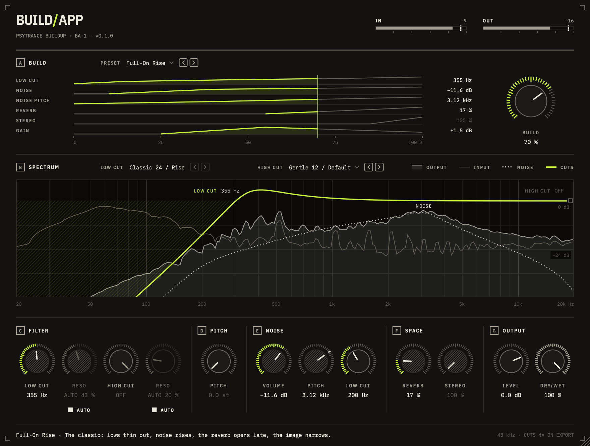

# BuildApp

A buildup effect for psytrance. Put it on the loop or the group you want to
build, ride the knobs over the last bars, and pull them back for the drop.
Twelve knobs and two filter-type menus, one chain. Or pick one of nineteen presets
and ride a single knob, **BUILD**, that moves the rest for you:



```
in ─┬─ pitch ─ low cut ─ high cut ─ + noise ─ reverb ─ stereo ─ makeup ─┐ wet
    └───────────────────────────────────────────────────────────────────┤ dry
                                                          dry/wet ─ level ─ out
```

VST3 and Audio Unit for macOS (universal), VST3 for Windows. JUCE 8.

## The knobs

| Knob | What it does |
|------|--------------|
| **Low cut** | Highpass, 20 Hz to 8 kHz, in the low cut type. All the way left: off. |
| **High cut** | Lowpass, 20 kHz down to 100 Hz, in the high cut type. All the way right: off. |
| **Low / high cut type** | The menus above the spectrum: eleven buildup and breakdown sounds for the low cut and ten for the high cut, each a filter style, slope and drive taken from FabFilter Volcano 3's factory presets (e.g. *Classic 24 / Rise*, *Gentle 12 / Soft*, *Gentle 12 / Default*). |
| **Reso** (one per cut) | The cut's resonance. With **Auto** on (the default) it moves with the cutoff the way the type wants: a low cut sings more the higher it climbs, a high cut is most resonant around 1.4 kHz and backs off when closed. While Auto is on the knob is greyed out and only shows where Auto has it; switch Auto off to set it yourself, starting where Auto had it. |
| **Pitch** | Up to +12 semitones, continuous, so it can be ridden through a build. |
| **Noise volume** | White noise on top of the signal (after the cuts), wide stereo. Left: off. |
| **Noise pitch** | Where the noise band sits, 80 Hz to 15 kHz. Its resonant top edge gives it a pitch; the level stays put while it sweeps. |
| **Noise low cut** | 24 dB/oct highpass on the noise only, 20 Hz to 8 kHz, resting at 200 Hz so the noise stays off the kick and bass. All the way left: off. |
| **Reverb** | One knob for the classic buildup wash: more send, a longer tail (0.8 s to 12 s), less dry, until the loop dissolves. It comes in gradually (−40 dB under the dry at 5 %, −12 dB at half). Back to zero cuts the tail within ~30 ms: the dry drop. |
| **Stereo** | 100 % is the image as it is; turning it up narrows it towards mono. |
| **Level** | Output gain, −36 to +12 dB. |
| **Dry/Wet** | The untouched input against the whole effect. |

With every knob at rest (low cut left, high cut right, everything else at
zero, stereo 100 %, level 0 dB, dry/wet 100 %) the signal passes bit for bit:
each stage at rest is skipped, not run at unity.

Every knob drags up/down (Shift for fine), takes the mouse wheel, types a value
on double-click (`340`, `4.2k`, `-6`, `off`) and resets on Alt/Cmd-click. The
cut markers in the spectrum can be dragged sideways too; drag one past the edge
of the plot, or double-click it, to switch that filter off. The preset and the
two cut-type menus have `<` `>` keys on their right to step through the list
(wrapping at the ends), and take the mouse wheel too. Hover over anything and
the footer says what it does.

### The display

- **A — Build**: the preset menu, a timeline of what the preset does (one lane
  per control it drives, plus the reverb and the level, which carry the fade
  into the tail; each lit in green from where it starts moving up to BUILD,
  with the value there on the right) and the BUILD knob. Click or drag
  the timeline to scrub BUILD; double-click it to drop to 0. With the preset
  Off the band folds away to its menu and the window gets shorter.
- **B — Spectrum**: the input (faint line) and the output (filled), with the
  cuts' response in green on its own scale (0 dB near the top) and what they
  take away hatched. The noise band shows dotted where it sits.
- **C–G**: the knobs. A knob the preset drives is hatched and follows BUILD;
  it can't be turned until the preset is switched off. The ring around a knob says what kind it is: green from
  the rest position to the value on the knobs that build tension (dark when
  the knob is at rest; the high cut rests on the right, so it lights to the
  left), one tick for noise pitch (a place, not an amount), bone around 0 dB
  for level, grey for dry/wet.

## Presets: the build on one knob

Pick a preset and every control it uses is locked to a path along BUILD's
travel. Automate BUILD over the 8 or 16 bars before the drop. **Level** and
**Dry/Wet** always stay yours, and so does every knob the preset leaves out.
Your own knob settings wait underneath: switch the preset to Off and they're
back.

- **0 %**: most presets leave the signal untouched here (bit for bit), so
  pulling BUILD back to 0 is the drop. Sunrise, the Pumping Up presets,
  Downsweep and Freefall start at a setting of their own instead (a closed
  lowpass, the downlifter's hit): no fade-in to automate.
- **0 to 75 %**: the preset's path, the build itself. Every control reaches
  its top here.
- **75 to 80 %**: the reverb comes up to at least 55 % for the tail (its knob
  locks from here on).
- **80 to 100 %**: only now does the level go, evenly in dB, from wherever the
  preset's gain left it down to −20 dB. The fade sits before the reverb, so
  the tail follows the music down. Stop at 75 % for the top of the path
  without any of this.

The paths follow what producers do by hand: entries are staggered (the low end
thins first, noise comes in mid-build, pitch rises late, the reverb opens in
the last third, the image narrows on the last bar), most of the motion is in
the last quarter, and brightness rises with the tension. Each preset holds its
loudness within a few LU of the dry signal (a makeup gain lane fills in where
the cuts take the low end away), so the drop is what hits. The noise sits
under the music: about 10 LU under it mid-build and 2 to 3 LU under it at the
top (White-Out, the noise riser, reaches level).

The three **Progressive** presets build the way progressive (psy)trance
does instead: an even climb with no late slam (they suit 16 to 32 bars),
the rolling bass thinned under a soft 12 dB low cut but never gone until the
drop, a lowpass that opens rather than closes, noise as air rather than
rumble, and the image or the wash pulled in on the last bar so the drop
lands in a tight, dry space.

The three **Pumping Up** presets bring the groove back the psytrance way:
it starts under a steep 48 dB lowpass, only the kick and bass pumping, and
opens from the bottom up. As it lets go near 20 kHz the low cut has already
started under 50 Hz and climbs on, so the two read as one sweep into the drop.

The three **Downlift** presets go the other way, for the bars after an impact
or into a break: 0 % is the hit, and BUILD takes it down.

The bars below count along a 16-bar path (the first 75 % of BUILD). Every
preset also ends in the fade towards its tail, so past 75 % the reverb is the
preset's even where the table leaves it to you.

| Preset | Style | What moves (on a 16-bar path) | Left to you |
|--------|-------|-------------------------------|-------------|
| **Full-On Rise** | the classic | low cut *Classic 24 / Rise* climbs to 920 Hz; noise from bar 2, sweeping up to 9 kHz; reverb from bar 9; the image narrows on the last two bars | high cut, pitch, noise low cut |
| **Rocket** | hi-tech | pitch from bar 5 to +12 st, slow then fast; low cut *Hard 48 / Flay* to 400 Hz; bright noise; a little narrowing at the end | high cut, reverb, noise low cut |
| **Stairs** | Goa | pitch up a semitone every bar from bar 5 (an octave by bar 16); low cut *Classic 12 / Thin* to 300 Hz; a short tail on the last bars | high cut, noise, stereo |
| **Acid Scream** | Goa / acid | low cut *Classic 48 / Scream* to 650 Hz with its resonance rising to 80 %; noise from bar 5; tail from bar 10 | high cut, pitch, stereo, noise low cut |
| **Tunnel** | progressive | high cut *Smooth 24 / Stutter* closes to 600 Hz; reverb grows; low noise from bar 7 | low cut, pitch, stereo, noise low cut |
| **Dark Forest** | dark / forest | low cut *Hollow 48 / Carve* and high cut *Hollow 12 / Warble* close in; a low wind of noise (150–720 Hz); a long cavern tail | pitch, stereo |
| **Dissolve** | psychill | reverb to a full 12 s wash that swallows the dry; low cut to 250 Hz, high cut to 4.5 kHz to keep it clean | pitch, noise, stereo |
| **White-Out** | noise riser | noise sweeps 135 Hz to 15 kHz and up to −7.5 dB, its low cut climbing to 1.3 kHz; reverb blurs the loop | both cuts, pitch, stereo |
| **Squeeze** | telephone | both cuts close in on the mids (650 Hz to 3 kHz) while the image goes mono | pitch, noise, reverb |
| **Vacuum** | late slam | nothing until bar 9, then low cut *Extreme 48 / Feed* to 1.5 kHz, a noise sweep and a collapse to mono; bone dry | high cut, pitch, reverb, noise low cut |
| **Sunrise** | progressive filter build | starts under high cut *Classic 48 / Gate* at 930 Hz, which opens evenly to 13 kHz, its resonance 35 to 55 %; low cut *Gentle 12 / Soft* to 355 Hz; noise from bar 5 follows the filter up (850 Hz to 6.8 kHz) | pitch, reverb, stereo, noise low cut |
| **Prog Roller** | prog psy groove | low cut *Smooth 12 / Pump* takes the sub in bar 1, then climbs evenly to 315 Hz; air from bar 2 (3.1 to 8 kHz, −31 to −14 dB); the image narrows evenly from bar 5 to 45 % width; bone dry | high cut, pitch, reverb, noise low cut |
| **Inhale** | wash and breath | a wash from bar 2 swelling to 7.7 s by bar 14, an airy noise (1.8 to 11.5 kHz, its low cut 400 Hz to 1.8 kHz), low cut *Clean 48 / Steep* slow to 140 Hz; then the last bars breathe in: tail to 1.5 s, low cut to 820 Hz, near mono | high cut, pitch |
| **Bottom Up** | pumping up | starts under high cut *Classic 48 / Gate* at 190 Hz (resonance 30 to 40 %) and a 40 % wide image; the lowpass lingers low, then opens to off by bar 12 as the image widens; low cut *Smooth 12 / Pump* takes over from bar 11 to 540 Hz | pitch, noise, reverb |
| **Handover** | pumping up, then full-on | starts under high cut *Hard 48 / Drive* at 170 Hz, open by bar 8; low cut *Classic 24 / Rise* takes over from bar 7 to 920 Hz; noise from bar 8 up to 9 kHz; reverb from bar 10; the image narrows at the end | pitch, noise low cut |
| **Surface** | up from underwater | starts under high cut *Classic 48 / Gate* at 260 Hz in a 3.7 s wash; the lowpass opens by bar 10 while the wash dries; low cut *Classic 12 / Thin* from bar 9 to 300 Hz; a 2.7 s tail comes back | pitch, noise, stereo |
| **Downsweep** | noise downlifter | starts at the hit: noise at −19 dB and 11.6 kHz falls fast, then slower, to 135 Hz and −49 dB, its low cut falling with it; high cut *Classic 12 / Vintage* closes to 1.8 kHz; the tail grows from 1.9 to 5.5 s | low cut, pitch, stereo |
| **Freefall** | pitch downlifter | starts an octave up and falls back to the original pitch, slow then fast; high cut *Hard 24 / Montoya* closes from bar 5 to 1.1 kHz; a noise burst at the hit falls from 8.9 kHz; the tail grows to 4.9 s | low cut, stereo, noise low cut |
| **Sink** | lowpass downlifter | high cut *Classic 48 / Gate* sinks the music to 150 Hz, fast at first; a rumble from bar 3 falls from 1.1 kHz to 100 Hz; the tail grows to 6.9 s; the image narrows from bar 7 to 40 % | low cut, pitch |

The presets were tuned by measurement: `buildapp_render <dir>` (built with
the core) renders every preset over a 16-bar build (BUILD 0 to 100 %, the fade
included) plus 4 bars of drop on the built-in loop to WAV and prints loudness,
brightness and width per bar.

## How it sounds the way it does

**Filters** (`CharacterFilter.cpp`, `FilterStyles.cpp`, `CutFilters.cpp`).
Each cut works the way FabFilter Volcano 3's filters do, worked out from its
binary and style files: a Chamberlin state-variable filter run three times per
sample on the held input (frequency coefficient 2 sin(π fc / 3 fs)), one stage
for 12 dB/oct, two for 24, four for 48, the band state clamped to ±1 and the
low state to ±10, then an atan soft clipper. Each of the eleven styles (Classic,
Smooth, Raw, Hard, Hollow, Extreme, Gentle, Tube, Metal, Easy Going, Clean) adds
an input gain, its clipper hardness and measured 11×11 surfaces that map
cutoff and resonance to the clipper drive, a cubic band damping and the
resonance the core really runs at; Clean is the linear core. The types in the
menus pair a style with a slope, a drive and an auto-resonance curve.
The cutoff glides per sample in log frequency (20 ms) and the resonance after
it (30 ms); changing type crossfades from the old filter to the new one,
which starts from the old one's state, and a change that comes during a
crossfade follows once it is done, so stepping through the types quickly (or
automating them) never jumps. Live the filters run at the host rate
like Volcano's; offline renders run them 4× oversampled (2× at 88.2/96 kHz)
through polyphase IIR halfbands, which cuts their aliasing by 15 dB and more
(Volcano's own "High Quality" only oversamples the clipper and measures within
a dB of normal). The spectrum draws the exact small-signal response, which
the tests check against a quiet sine through every type at every rate.

**Pitch** (`PitchShifter.cpp`). A phase vocoder with peak locking
(Laroche & Dolson): every spectral peak and the bins around it move up
together, with their phases turned by how far that partial has travelled, so
partials come out at exactly the interval and keep their shape. A frame where
the highs jump (a hit) restarts from the analysed phases, so drums keep their
attack. The frames are taken of the analytic signal (a 90° allpass pair), so
a low note's mirror image cannot leak into it: a 41 Hz sine shifts with
−53 dB residual or better (−18 to −28 dB without). That allpass pair runs
the lows late (7 ms at 30 Hz), so each bin turns its phase back out and
kicks land in one piece.
The analysis window is 4096 points but asymmetric, with an 8 ms tail and a
synthesis window on that tail only (Mauler & Martin), so the shifted signal
runs 16 ms late. Only while the pitch is up: at 0 semitones the stage passes
the signal untouched with no delay, and it fades in and out over 25 ms.
Waking up, it runs its frames on schedule over the recent input and starts
the fade 16 ms later, once the shifted signal is whole: no cold start, and no
burst of frames in one audio block (which at small buffer sizes would drop
out just as a preset's pitch lane leaves 0).
Offline renders use an analysis window twice as long at the same 16 ms, so a
bounce lines up with what was heard. On an eight-note chord the artifacts sit
15–17 dB (live) and 17–21 dB (export) under the shifted notes; the old
delay-line shifter managed 2–9 dB. The 16 ms is not reported to the host, so
expect a little flamming against the dry signal at dry/wet below 100 %.

**Noise** (`NoiseSource.cpp`). Independent white noise per channel through a
resonant 2-pole lowpass with a highpass two octaves under it. The gain that
keeps its RMS at −12 dBFS (full volume) wherever the band sits is computed
from the filter response. The noise low cut (4-pole Butterworth) comes after
that gain, so it takes the lows away instead of being made up for.

**Reverb** (`Reverb.cpp`). The send is cut below 160 Hz and above 9 kHz, so
the wash never muddies kick and bass. Four diffusion steps (8 channels each:
delays, Hadamard mix, polarity flips) feed an 8-line feedback delay network
with a Householder matrix, slowly modulated lines (no metallic ringing) and a
high shelf in the loop so the highs die first. The overall level stays within
about 1.5 dB from 0 to 100 % while the wash rises to ~6 dB above what is sent
into it.

When the host stops or jumps in the timeline (it resets the plug-in), the
reverb tail and the pitch history are cleared, so nothing from before the
jump rings into what follows. With the same input, an offline render repeats
exactly, noise included.

The whole chain uses about 1 % of one core at 48 kHz with the pitch at 0, and
about 8 % with everything on (the phase vocoder is the rest; Apple M4 Pro).

## Building

Requirements: macOS 11+, CMake 3.24+, Ninja, Xcode command line tools.

```sh
cmake -B build -G Ninja -DCMAKE_BUILD_TYPE=Release
cmake --build build
```

This installs the VST3 and AU into `~/Library/Audio/Plug-Ins`. JUCE 8 is
downloaded automatically; pass `-DFETCHCONTENT_SOURCE_DIR_JUCE=/path/to/JUCE`
to use a local checkout.

### Core only

The DSP doesn't depend on JUCE and builds in seconds:

```sh
cmake -B build-core -G Ninja -DCMAKE_BUILD_TYPE=Release -DBUILDAPP_BUILD_PLUGIN=OFF
cmake --build build-core
./build-core/buildapp_tests
./build-core/buildapp_render <dir>   # every preset's build as WAV, with per-bar measurements
```

### UI snapshots

`build/buildapp_snapshot_artefacts/Release/buildapp_snapshot <dir>`
renders the editor to PNGs (rest, build, peak, cuts, types, and the presets
rise, squeeze, vacuum, sunrise, pumping, tail and downlift) with the built-in loop playing through it, no DAW
needed. `... <dir> bench` times the paints instead.

### Trying it without a DAW

```sh
./start.sh               # the built-in 145 BPM psytrance loop
./start.sh track.wav     # your file, looped
```

`start.sh` builds and opens the demo host: the plugin in a window with the
loop running through it and out of your speakers. **BYPASS** plays it
untouched for comparison; space plays and stops.

### Releases

Push a version tag and GitHub Actions builds, tests and validates the plugins
(pluginval at strictness 5, auval) and attaches the installers to a new
release:

```sh
git tag v1.2.0 && git push origin v1.2.0
```

You get a macOS `.pkg` (universal, VST3 + AU), a Windows setup `.exe` (VST3)
and a zip of the bare plug-ins for each. A suffix such as `v1.2.0-beta.1` makes
it a pre-release. The installer scripts are in `packaging/`.

The macOS build is signed with a Developer ID and notarized when these
repository secrets are set (Settings > Secrets and variables > Actions):

| Secret | Value |
|--------|-------|
| `MACOS_CERTIFICATES_P12` | base64 of a `.p12` holding both the *Developer ID Application* and the *Developer ID Installer* certificate with their keys |
| `MACOS_CERTIFICATES_PASSWORD` | the `.p12` password |
| `NOTARY_APPLE_ID` | Apple ID of the developer account |
| `NOTARY_PASSWORD` | an app-specific password for that Apple ID |

Without them the macOS build is unsigned and macOS blocks the `.pkg` the first
time (System Settings > Privacy & Security > Open Anyway). The Windows
installer is not signed, so SmartScreen asks once (More info > Run anyway).

## Project layout

```
src/core/dsp       trapezoidal SVF, polyphase halfbands, smoothers, FFT
src/core/fx        cut filters, pitch shifter, noise, reverb, the chain, knob mappings, presets
src/core/analysis  lock-free audio taps, live spectrum
src/plugin         JUCE processor and editor, number formatting
src/ui             theme, knobs and meters, spectrum view, build timeline
tests/             Catch2 tests for the core, test signals (incl. the psy loop)
tools/             offscreen UI snapshot tool, demo host, preset renderer
packaging/         macOS pkg and Windows installer scripts
```

## License

The plugin links JUCE 8 under the AGPLv3. IBM Plex fonts under the SIL Open
Font License (`resources/fonts/IBMPlex-OFL.txt`).
